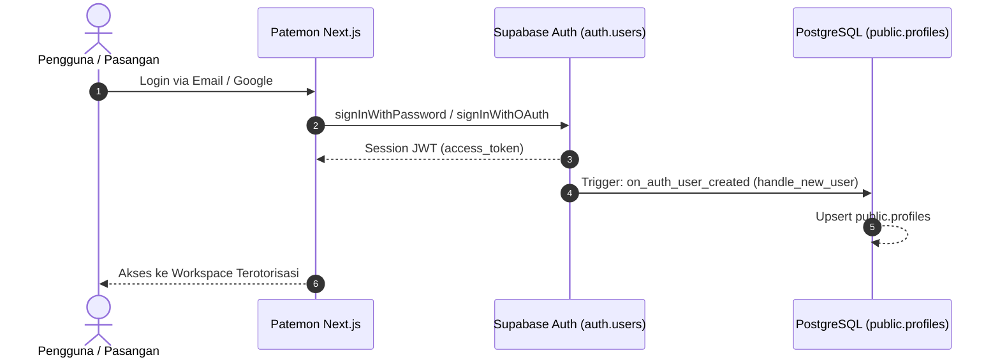

# Patemon — Authentication, Memberships & Row Level Security (RLS)

**Version:** 1.0 (MVP v1) · **Updated:** 2026-11-14 · **Phase:** 03 Foundation & Architecture ([Issue #15](https://github.com/andresanjaya/patemon/issues/15))

---

## 1. Authentication Architecture

Patemon menggunakan **Supabase Auth** untuk autentikasi pengguna dengan dukungan Email/Password dan Google OAuth:
- Setiap pengguna baru yang mendaftar di `auth.users` secara otomatis memicu trigger `on_auth_user_created` yang mengeksekusi `handle_new_user()`.
- Data publik pengguna disinkronkan ke tabel `public.profiles` (`id`, `email`, `full_name`, `avatar_url`).
- Kredensial sensitif dikelola langsung oleh Supabase Auth, tidak pernah disimpan di tabel publik.



---

## 2. Hirarki Peran & Matriks Otorisasi Workspace

Setiap workspace pernikahan (`weddings`) memiliki daftar anggota di `wedding_members` dengan tiga tingkat peran hierarkis:

$$\text{owner} > \text{editor} > \text{viewer}$$

| Peran (*Role*) | Deskripsi | Hak Akses |
| :--- | :--- | :--- |
| **Owner** | Calon pengantin atau penanggung jawab utama workspace | Akses penuh: manajemen anggota (undang/ubah role/hapus), hapus workspace, beli paket akses, dan kelola seluruh konten. |
| **Editor** | Pasangan, keluarga inti, atau koordinator acara (PIC) | Operasional penuh: tambah, ubah, dan hapus rangkaian upacara, banten, anggaran, vendor, tamu, dan rundown. Tidak dapat menghapus workspace atau mengelola anggota. |
| **Viewer** | Keluarga besar, serati banten, atau peninjau adat | *Read-only*: dapat melihat seluruh informasi persiapan upacara tanpa hak mengubah atau menghapus data. |

### Matriks Izin Operasional (*Permission Matrix*)

| Resource | Action | Owner | Editor | Viewer | Non-Member / Anon |
| :--- | :--- | :---: | :---: | :---: | :---: |
| **Workspace (`weddings`)** | Read | ✅ | ✅ | ✅ | ❌ |
| | Update Settings | ✅ | ❌ | ❌ | ❌ |
| | Delete Workspace | ✅ | ❌ | ❌ | ❌ |
| **Anggota (`wedding_members`)** | View Members | ✅ | ✅ | ✅ | ❌ |
| | Invite / Remove Member | ✅ | ❌ | ❌ | ❌ |
| **Upacara (`wedding_ceremonies`)** | View | ✅ | ✅ | ✅ | ❌ |
| | Create / Edit / Delete | ✅ | ✅ | ❌ | ❌ |
| **Banten & Sarana (`wedding_ritual_items`)**| View | ✅ | ✅ | ✅ | ❌ |
| | Create / Edit / Delete | ✅ | ✅ | ❌ | ❌ |
| **Tugas & Checklist (`wedding_tasks`)** | View | ✅ | ✅ | ✅ | ❌ |
| | Create / Edit / Delete | ✅ | ✅ | ❌ | ❌ |
| **Anggaran & Bayar (`budget_items/payments`)**| View | ✅ | ✅ | ✅ | ❌ |
| | Create / Edit / Delete | ✅ | ✅ | ❌ | ❌ |
| **Vendor & Tamu (`vendors/guests`)** | View | ✅ | ✅ | ✅ | ❌ |
| | Create / Edit / Delete | ✅ | ✅ | ❌ | ❌ |
| **Rundown Acara (`rundown_events`)** | View | ✅ | ✅ | ✅ | ❌ |
| | Create / Edit / Delete | ✅ | ✅ | ❌ | ❌ |
| **Katalog Master (`ritual_catalog`, dll)** | Read (Public/Active) | ✅ | ✅ | ✅ | ✅ |
| | Modify Master Data | ❌ (Service Role Only) | ❌ | ❌ | ❌ |
| **Orders & Access (`checkout_orders`)** | View | ✅ | ✅ | ✅ | ❌ |
| | Create Order | ✅ | ✅ | ❌ | ❌ |
| | Webhook Event Logs (`payment_events`)| ❌ (Service Role Only) | ❌ | ❌ | ❌ |

---

## 3. Fungsi Otorisasi PostgreSQL (Database Level)

Untuk mengevaluasi otorisasi secara efisien dan konsisten pada setiap query, migrasi [20261114000002_auth_and_rls.sql](file:///c:/Andre/My%20Code/patemon/supabase/migrations/20261114000002_auth_and_rls.sql) menyediakan fungsi:

### 3.1 `public.get_wedding_role(p_wedding_id UUID) RETURNS TEXT`
- Mengecek status keanggotaan aktif pengguna (`auth.uid()`) pada workspace terkait.
- Jika pengguna adalah pembuat awal workspace (`weddings.created_by = auth.uid()`), otomatis ditetapkan sebagai `owner`.
- Mengembalikan `NULL` jika bukan anggota atau tidak terotentikasi.

### 3.2 `public.has_wedding_role(p_wedding_id UUID, p_required_role TEXT) RETURNS BOOLEAN`
- Mengevaluasi apakah pengguna memiliki hak akses yang setara atau lebih tinggi dari peran yang diminta:
  - `p_required_role = 'viewer'`: mengizinkan `owner`, `editor`, dan `viewer`.
  - `p_required_role = 'editor'`: mengizinkan `owner` dan `editor`.
  - `p_required_role = 'owner'`: hanya mengizinkan `owner`.

### 3.3 `public.get_user_wedding_ids() RETURNS TABLE(wedding_id UUID)`
- Mengembalikan daftar `wedding_id` yang dapat diakses oleh pengguna saat ini untuk query batch dan filter dasbor.

---

## 4. Supabase Client Factories & Proteksi Service Role

Untuk menjamin kepatuhan arsitektur keamanan:

1. **Browser Client (`src/lib/supabase/client.ts`):**
   - Hanya menggunakan `NEXT_PUBLIC_SUPABASE_URL` dan `NEXT_PUBLIC_SUPABASE_ANON_KEY`.
   - Mengikuti batasan RLS database sepenuhnya berdasarkan sesi login pengguna.

2. **Server Client (`src/lib/supabase/server.ts`):**
   - Menggunakan `createServerClient` dari `@supabase/ssr` dengan pembacaan dan penerusan cookie (`await cookies()`).
   - Digunakan pada Server Components, Server Actions, dan Route Handlers.

3. **Admin Client (`src/lib/supabase/admin.ts`):**
   - Menggunakan `SUPABASE_SERVICE_ROLE_KEY`.
   - **Diproteksi dengan package `server-only`:** Jika ada komponen klien yang mencoba mengimpor berkas ini, proses build Next.js akan langsung gagal secara otomatis.
   - Hanya digunakan untuk alur sensitif: webhook verifikasi Midtrans dan pembaruan `access_grants`.

---

## 5. Pengujian Otomatis

Pengujian unit dan isolasi multi-tenant diuji secara otomatis pada [tests/auth-rls.test.ts](file:///c:/Andre/My%20Code/patemon/tests/auth-rls.test.ts):
```bash
# Menjalankan pengujian RLS & izin otorisasi
pnpm test
```
Seluruh pengujian mencakup verifikasi:
- Matriks izin untuk setiap peran (`owner`, `editor`, `viewer`, `null`).
- Penolakan akses lintas workspace (*cross-wedding isolation rejection*).
- Perlindungan kunci rahasia (*service role key never leaked client-side*).
- Ketersediaan `ENABLE ROW LEVEL SECURITY` pada seluruh tabel migrasi.

