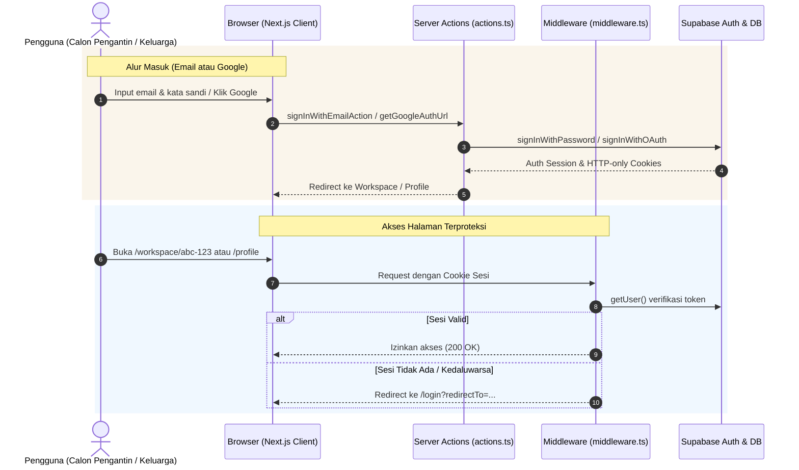

# Patemon — Panduan Autentikasi, Sesi & Manajemen Profil

**Version:** 1.0 (MVP v1) · **Updated:** 2026-11-14 · **Phase:** 04 Product Development ([Issue #18](https://github.com/andresanjaya/patemon/issues/18))

---

## 1. Arsitektur Autentikasi Pengguna

Patemon menggunakan arsitektur autentikasi berbasis **Supabase Auth** dan **Next.js App Router (Server Actions + Middleware)** untuk menjamin keamanan, persistensi sesi, dan kemudahan akses bagi pasangan serta keluarga:

---

## 2. Fitur & Rute Autentikasi

| Rute Halaman | Komponen UI | Deskripsi Fungsional |
| :--- | :--- | :--- |
| `/login` | `LoginForm` | Masuk via Email/Password atau Google OAuth. Dilengkapi tautan reset password dan validasi error ramah bahasa Indonesia. |
| `/register` | `RegisterForm` | Pendaftaran akun baru dengan nama lengkap, email, dan kata sandi minimal 6 karakter. Otomatis sinkron ke tabel `profiles`. |
| `/reset-password` | `ResetPasswordForm` | Permintaan pengiriman tautan pemulihan kata sandi ke email terdaftar. |
| `/update-password` | `UpdatePasswordForm` | Formulir pembaruan kata sandi baru setelah pengguna mengklik tautan dari email. |
| `/auth/callback` | Route Handler (`route.ts`) | Penukaran kode OAuth (*code exchange*) menjadi sesi cookie aktif untuk Google Login dan konfirmasi email. |
| `/profile` | `ProfileForm` | Halaman pengaturan profil pengguna (nama lengkap, kontak telepon/WhatsApp, dan tampilan email akun). |

---

## 3. Proteksi Halaman & Middleware (`src/middleware.ts`)

Next.js Middleware berjalan pada *edge runtime* di setiap request:
- **Penyegaran Sesi (*Session Refresh*):** Memperbarui token autentikasi pada cookie browser secara otomatis saat mendekati masa kedaluwarsa.
- **Rute Terproteksi:**
  - `/workspace/*` (kecuali `/workspace/demo` untuk preview publik), `/profile/*`, dan `/settings/*`.
  - Jika pengguna belum masuk, otomatis dialihkan ke `/login?redirectTo=<target_path>`.
- **Rute Auth Tamu:**
  - `/login`, `/register`, dan `/reset-password`.
  - Jika pengguna telah login, otomatis dialihkan ke workspace aktif untuk mencegah form login ganda.

---

## 4. Penanganan Error yang Ramah (*Friendly Auth Errors*)

Supabase Auth mengembalikan pesan galat berbahasa Inggris atau kode error internal. Patemon menerjemahkannya secara otomatis ke dalam pesan ramah pengguna berbahasa Indonesia melalui [src/features/auth/errors.ts](file:///c:/Andre/My%20Code/patemon/src/features/auth/errors.ts):

| Error Supabase Asli | Pesan Ramah Patemon (Bahasa Indonesia) |
| :--- | :--- |
| `Invalid login credentials` | *Email atau kata sandi yang Anda masukkan tidak sesuai.* |
| `User already registered` | *Email ini sudah terdaftar. Silakan masuk dengan kata sandi Anda.* |
| `Email not confirmed` | *Email Anda belum dikonfirmasi. Silakan periksa tautan verifikasi pada inbox atau spam email Anda.* |
| `Password should be at least 6 characters` | *Kata sandi minimal harus terdiri dari 6 karakter.* |
| `For security purposes, you can only request this once every 60 seconds` | *Terlalu banyak percobaan. Silakan tunggu 60 detik sebelum mencoba kembali.* |

---

## 5. Konfigurasi Google OAuth di Dashboard Supabase

Untuk mengaktifkan login Google di lingkungan produksi atau staging:
1. Buka Google Cloud Console > **APIs & Services > Credentials**.
2. Buat **OAuth 2.0 Client ID** (tipe Web Application).
3. Tambahkan **Authorized redirect URI**:
   `https://egvddkmycfbzmlafdwoc.supabase.co/auth/v1/callback`
4. Masukkan Client ID dan Client Secret ke **Supabase Dashboard > Authentication > Providers > Google**.
5. Simpan pengaturan. Alur login satu klik langsung aktif secara otomatis di aplikasi Patemon.

