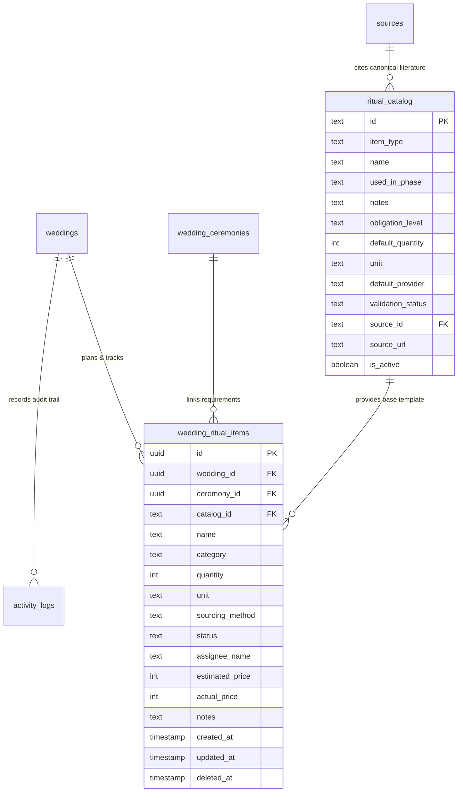
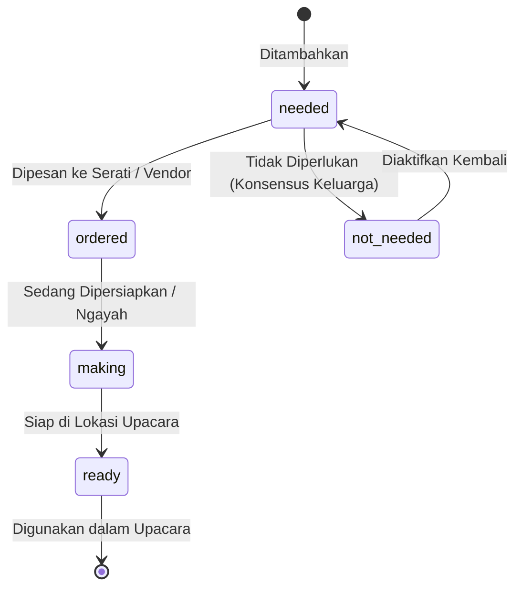

# Banten & Ritual Materials Planner Guide

**Product:** Patemon · Bali Hindu Wedding Planner  
**Feature:** Banten Checklist, Canonical Catalog Import, Sourcing Method Tracking & Budget Synchronization  
**Issue:** [#26 — Implement banten and ritual materials planner](https://github.com/andresanjaya/patemon/issues/26)  
**Status:** Implemented & Verified

---

## 1. Overview & Cultural Significance

In Balinese Hindu *pawiwahan*, *upakara* (offerings and ritual equipment) embody the spiritual and social essence of the wedding. Families typically balance:
1. **Pesan Paket Serati Banten:** Ordering major packages (such as *Banten Mebyakala* and *Banten Pawiwahan Sanggah Kamulan*) from experienced serati banten or griya.
2. **Ngayah Keluarga / Buat Sendiri:** Handcrafting daily offerings, *canang sari*, *segehan*, and fruit arrangements through communal cooperation (*ngayah / mejejahitan*) among family and banjar members.
3. **Tugas Khusus Kerabat:** Assigning specific sacred elements (such as *Kelapa Gading Kembar* or *Perlengkapan Tegen-tegenan*) to close relatives.

The **Banten Planner** provides a structured digital dashboard to track all offerings, components, suppliers, procurement stages, and associated expenses.

---

## 2. Route & Screen Architecture

```
/workspace/[weddingId]
   │
   ├── /onboarding             # Guided onboarding wizard (Issue #20)
   ├── /ceremonies             # Ceremony list & detail management (Issue #25)
   │     └── /[ceremonyId]     # Ceremony rundown and linked ritual items
   │
   ├── /banten                 # Centralized Banten & Sarana Planner (Issue #26)
   │     ├── Modal: BantenItemModal      # Create or edit individual item
   │     └── Modal: CatalogPickerModal   # Multi-select import from literature catalog
   │
   └── /settings               # Workspace configuration
```

---

## 3. Data Model & Relationships



---

## 4. Sourcing Methods & Acquisition Lifecycle

### 4.1 Sourcing Methods
| Method Key | Indonesian Display | Description |
|---|---|---|
| `purchased_package` | **Beli Paket Serati** | Banten lengkap dipesan ke praktisi serati banten atau griya |
| `self_made` | **Ngayah Keluarga** | Dibuat sendiri bersama keluarga dan banjar (*mejejahitan*) |
| `family_assigned` | **Tugas Keluarga** | Ditugaskan khusus kepada kerabat purusa/pradana tertentu |
| `vendor_order` | **Pesan Vendor** | Perlengkapan komersial khusus (dekorasi janur, tenda, sound) |

### 4.2 Acquisition Status Workflow
Items transition sequentially through 5 states:


---

## 5. Financial & Budget Integration

- **Integer IDR:** All amounts are stored strictly as integer Rupiah values (`estimated_price`, `actual_price`) avoiding floating-point imprecision.
- **Independent Tracking:** Expenses recorded in `wedding_ritual_items` are isolated per wedding workspace. Items marked `not_needed` are automatically excluded from active cost totals.
- **Transparency:** Displays both estimated vs actual realized costs for financial accountability.

---

## 6. Security, Authorization & Privacy

- **Row Level Security (RLS):** All database operations enforce tenant isolation through `wedding_id = :weddingId`.
- **Role Permissions:**
  - `owner` & `editor`: Full create, update, delete, status toggle, and catalog import capabilities.
  - `viewer`: Read-only access; action buttons and modal forms are disabled.
- **Audit Logging:** Critical actions (`banten.created`, `banten.updated`, `banten.deleted`, `banten.catalog_imported`) are recorded in `activity_logs`.

---

## 7. Cultural Guardrails & Provenance

In strict compliance with Patemon's cultural tenets:
- **No Inflexible Dogma:** The application highlights that offering variations reflect *Desa, Kala, Patra* and local dresta.
- **Visible Literature Sources:** Catalog imports display links back to authoritative literature (`SRC-001` PHDI, `SRC-002` Baliloka, `SRC-003` Pasamuhan).
- **No Fabricated Defaults:** Prices and quantities remain flexible until confirmed by the couple, family elders, and their chosen serati.

