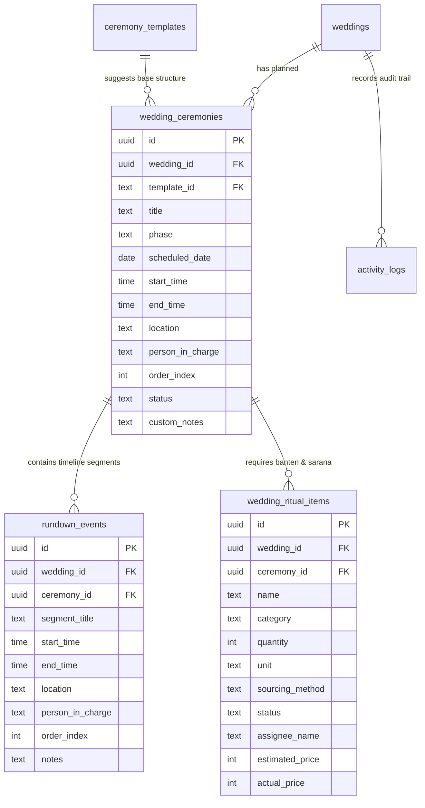

# Ceremony Management & Detail Guide

**Product:** Patemon · Bali Hindu Wedding Planner  
**Feature:** Ceremony List, Detail Management, Rundown Segments & Banten Association  
**Issue:** [#25 — Implement ceremony list and ceremony detail management](https://github.com/andresanjaya/patemon/issues/25)  
**Status:** Implemented & Verified

---

## 1. Overview & Objectives

In a Balinese Hindu wedding (*pawiwahan*), ceremonies are multi-layered events composed of chronological ritual segments, specific ceremonial offerings (*banten*), designated family or banjar roles, and tight coordination with pemangku/serati.

The **Ceremony Management Module** provides couples and extended families with:
1. **Daftar Upacara Adat (`/workspace/[weddingId]/ceremonies`):** Comprehensive view of all planned ceremonies, filterable by phase (*Persiapan*, *Puncak Acara*, *Pasca Pawiwahan*), searchable by title/location/PIC, with real-time status counters and the ability to add custom ceremonies.
2. **Detail Upacara & Rundown (`/workspace/[weddingId]/ceremonies/[ceremonyId]`):** Individual ceremony management page featuring:
   - Schedule, start/end time, location, PIC, dress code, and notes.
   - Provenance badges and cultural guidance notes.
   - **Rundown Jam-demi-Jam (`rundown_events`):** Chronological agenda segments with PIC and venue specifications.
   - **Kebutuhan Banten & Sarana (`wedding_ritual_items`):** Dedicated banten procurement tracking for the ceremony.

---

## 2. Route & Screen Architecture

```
/workspace/[weddingId]
   │
   ├── /onboarding             # Guided onboarding wizard (Issue #20)
   │
   ├── /ceremonies             # Ceremony overview list & filter (Issue #25)
   │     │
   │     └── /[ceremonyId]     # Ceremony detail, rundown, and banten (Issue #25)
   │
   └── /settings               # Workspace settings & members
```

---

## 3. Data Relationships



---

## 4. Status Workflows

### Ceremony Preparation Status
- **`draft` (Rencana):** Preliminary ceremony idea or suggestion from onboarding.
- **`confirmed` (Terkonfirmasi):** Date, venue, and PIC agreed upon by family and pemangku.
- **`completed` (Selesai):** Ritual has been fully performed and witnessed.
- **`skipped` (Dilewati):** Not performed for this wedding based on family/dresta consensus.

### Banten Acquisition Lifecycle
Items linked to each ceremony cycle through 5 distinct states:
1. **`needed` (Dibutuhkan):** Identified as a requirement; awaiting supplier or assignment.
2. **`ordered` (Dipesan):** Ordered from serati banten or vendor package.
3. **`making` (Sedang Dibuat):** Under active preparation (*ngayah* / mejejahitan with family).
4. **`ready` (Siap):** Delivered and verified complete at the ceremony venue.
5. **`not_needed` (Tidak Diperlukan):** Omitted per specific banjar/griya advice.

---

## 5. Security & Access Control

- **Role Guardrails:**
  - `owner` & `editor`: Full create, update, reorder, and delete access on ceremonies, rundown events, and ritual items.
  - `viewer`: Read-only access. Form actions, modals, and status toggle buttons are automatically disabled.
- **Multi-Tenant Isolation:**
  - All queries and mutations enforce `wedding_id = :weddingId` matching user's active membership or ownership verified through Supabase RLS.
- **Audit Logging:**
  - Significant mutations (`ceremonies.created`, `ceremonies.updated`, `ceremonies.deleted`) are permanently recorded in `activity_logs`.

---

## 6. Cultural Guardrails & Provenance

In strict alignment with Patemon's cultural principles:
- **No Inflexible Prescriptions:** Regional dresta (*Desa, Kala, Patra*) always takes precedence.
- **Provenance Citations:** Canonical templates link to vetted publications (`SRC-001`, `SRC-002`, `SRC-003`).
- **Conditional Customs Warnings:** Rites requiring specific agreements (such as *Madengen-dengen* or *Mejauman*) prominently display amber warning banners reminding the couple to seek counsel from their family elders and local pemangku.

