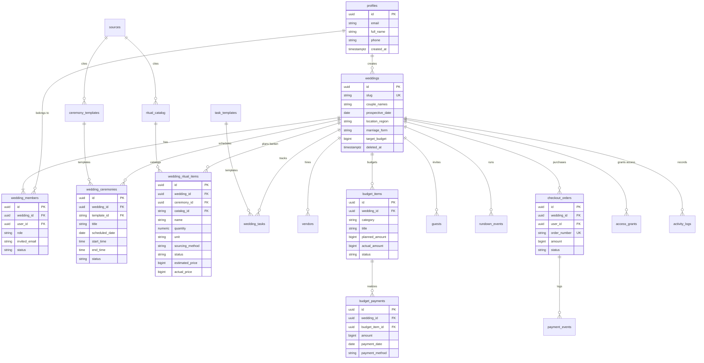

# Patemon — PostgreSQL Database Schema & Migration Guide

**Version:** 1.0 (MVP v1) · **Updated:** 2026-11-14 · **Phase:** 03 Foundation & Architecture ([Issue #14](https://github.com/andresanjaya/patemon/issues/14))

---

## 1. Core Architectural Decisions

### 1.1 Tenant Isolation by `wedding_id`
Patemon models weddings as isolated collaborative workspaces:
- Every wedding-scoped operational table directly references `wedding_id UUID REFERENCES weddings(id) ON DELETE CASCADE`.
- Security boundaries are strictly maintained at the PostgreSQL level via Row Level Security (RLS) in [Issue #15](https://github.com/andresanjaya/patemon/issues/15).
- Cross-workspace queries are impossible because all client queries require an authorized `wedding_id` membership grant.

### 1.2 Integer IDR Monetary Policy
- **No Floating-Point Money:** All financial columns (`target_budget`, `estimated_price`, `actual_price`, `planned_amount`, `actual_amount`, `amount`, `quote_amount`) are stored as PostgreSQL `BIGINT` representing discrete Indonesian Rupiah (IDR).
- **Non-Negative Constraints:** Tables enforce `CHECK (amount >= 0)` or `CHECK (amount > 0)` to guarantee balance integrity.
- **Double-Counting Prevention:** Paket banten yang dipesan sekaligus tidak dihitung ganda dengan sarana banten lepasan berkat relasi eksplisit antara `budget_items.linked_ritual_item_id` dan `wedding_ritual_items`.

### 1.3 Date & Timezone Semantics (`Asia/Makassar` / WITA)
- **Global Audit Timestamps (`TIMESTAMPTZ`):** Semua log sistem, waktu pembuatan transaksi (`created_at`, `updated_at`, `transaction_time`, `settlement_time`, `deleted_at`) disimpan dalam format UTC `TIMESTAMPTZ`.
- **Kalender Hari Baik / Tanggal Upacara (`DATE`):** Tanggal upacara adat (`prospective_date`, `scheduled_date`, `due_date`) disimpan sebagai `DATE` murni tanpa zona waktu. Ini memastikan penanggalan Bali (sukra, pon, wuku) tidak bergeser sehari ke depan/belakang akibat konversi UTC browser klien.
- **Rundown Acara (`TIME WITHOUT TIME ZONE`):** Waktu jam prosesi hari-H (`start_time`, `end_time`) ditafsirkan dalam waktu lokal Bali (`Asia/Makassar`, UTC+08:00).

### 1.4 Kebijakan Soft-Delete & Hard-Delete
- **Soft-Delete (`deleted_at TIMESTAMPTZ DEFAULT NULL`):** Diterapkan pada entitas utama yang dikelola pengguna (`weddings`, `wedding_ceremonies`, `wedding_ritual_items`, `wedding_tasks`, `budget_items`, `vendors`, `guests`). Pengguna dapat memulihkan item yang tidak sengaja terhapus. Indeks parsial `WHERE deleted_at IS NULL` memastikan performa query tetap maksimal.
- **Hard-Delete (Cascade):** Diterapkan pada data relasi otorisasi (`wedding_members`) saat workspace dihapus, serta log pembayaran riil dan event webhook yang bersifat *immutable*.

---

## 2. Entity-Relationship Diagram (ERD)



---

## 3. Data Dictionary

### 3.1 Identitas & Keanggotaan Workspace

| Tabel | Kolom Kunci | Keterangan & Batasan |
| :--- | :--- | :--- |
| `profiles` | `id (PK UUID)`, `email`, `full_name`, `phone` | Terhubung langsung dengan `auth.users(id)` Supabase. |
| `weddings` | `id (PK UUID)`, `couple_names`, `marriage_form`, `target_budget` | Workspace utama. `marriage_form` divalidasi: `memadik`, `ngerorod`, `nyentana`, `custom`. |
| `wedding_members` | `wedding_id (FK)`, `user_id (FK)`, `role`, `status` | Hak akses multi-user. `role`: `owner`, `editor`, `viewer`. |

### 3.2 Katalog Master Terkurasi & Bersumber (Global)

| Tabel | Kolom Kunci | Keterangan & Batasan |
| :--- | :--- | :--- |
| `sources` | `id (PK TEXT)`, `title`, `source_type`, `source_url` | Sumber rujukan adat terverifikasi (misal: Keputusan Bersama PHDI & MDA Bali, dokumen Depdikbud). |
| `ceremony_templates` | `id (PK TEXT)`, `phase`, `name`, `validation_status` | Template prosesi adat dari pra-nikah hingga mejaya-jaya. |
| `ritual_catalog` | `id (PK TEXT)`, `item_type`, `name`, `obligation_level` | Katalog master sarana banten (Pejati, Peras, Daksina, dll) dengan label kewajiban (*kondisional / perlu verifikasi*). |
| `task_templates` | `id (PK TEXT)`, `phase`, `target_timeline`, `priority` | Rujukan master checklist persiapan (H-365 hingga hari-H). |
| `budget_item_templates` | `id (PK TEXT)`, `category`, `title`, `estimated_price` | Template estimasi pos biaya untuk acuan awal. |

### 3.3 Operasional Perencanaan Pernikahan (Wedding-Scoped)

| Tabel | Kolom Kunci | Keterangan & Batasan |
| :--- | :--- | :--- |
| `wedding_ceremonies` | `id (PK UUID)`, `wedding_id (FK)`, `scheduled_date`, `status` | Rangkaian upacara spesifik pasangan. Status: `draft`, `confirmed`, `completed`, `skipped`. |
| `wedding_ritual_items` | `id (PK UUID)`, `wedding_id (FK)`, `status`, `sourcing_method` | Manajemen pengadaan banten (*needed, ordered, making, ready, not_needed*). |
| `wedding_tasks` | `id (PK UUID)`, `wedding_id (FK)`, `due_date`, `status`, `priority` | Checklist tugas keluarga dengan PIC dan status penyelesaian. |
| `vendors` | `id (PK UUID)`, `wedding_id (FK)`, `category`, `quote_amount`, `status` | Catatan kontak & kesepakatan vendor (serati banten, rias, dekorasi, dokumentasi). |
| `budget_items` | `id (PK UUID)`, `wedding_id (FK)`, `planned_amount`, `actual_amount` | Pos anggaran tersimpan dalam IDR integer. |
| `budget_payments` | `id (PK UUID)`, `budget_item_id (FK)`, `amount`, `payment_date` | Realisasi cicilan/pembayaran biaya riil. |
| `guests` | `id (PK UUID)`, `wedding_id (FK)`, `name`, `side`, `headcount` | Daftar undangan pihak purusa/pradana tanpa kompleksitas public RSVP di v1. |
| `rundown_events` | `id (PK UUID)`, `wedding_id (FK)`, `start_time`, `end_time`, `PIC` | Susunan acara menit demi menit pada hari-H. |

### 3.4 Monetisasi & Jejak Audit

| Tabel | Kolom Kunci | Keterangan & Batasan |
| :--- | :--- | :--- |
| `checkout_orders` | `id (PK UUID)`, `order_number`, `amount`, `status` | Transaksi pembayaran akses workspace via Midtrans Snap. |
| `payment_events` | `id (PK UUID)`, `order_id (FK)`, `payload`, `is_verified` | Log audit webhook pembayaran dengan verifikasi signature server. |
| `access_grants` | `id (PK UUID)`, `wedding_id (FK)`, `status`, `valid_until` | Entitlement hak akses aktif ke fitur premium per wedding. |
| `activity_logs` | `id (PK UUID)`, `wedding_id (FK)`, `action`, `details` | Jejak audit perubahan penting per workspace. |

---

## 4. Alur Kerja Migrasi Supabase

### 4.1 Menjalankan Migrasi Lokal
```bash
# Reset database lokal dan terapkan semua migrasi
pnpm dlx supabase db reset

# Membuat berkas migrasi baru jika ada perubahan skema
pnpm dlx supabase migration new nama_migrasi
```

### 4.2 Verifikasi Skema
Pastikan seluruh tabel dan trigger berjalan tanpa error sebelum melanjutkan ke penerapan Row Level Security (RLS) pada **Issue #15**.

