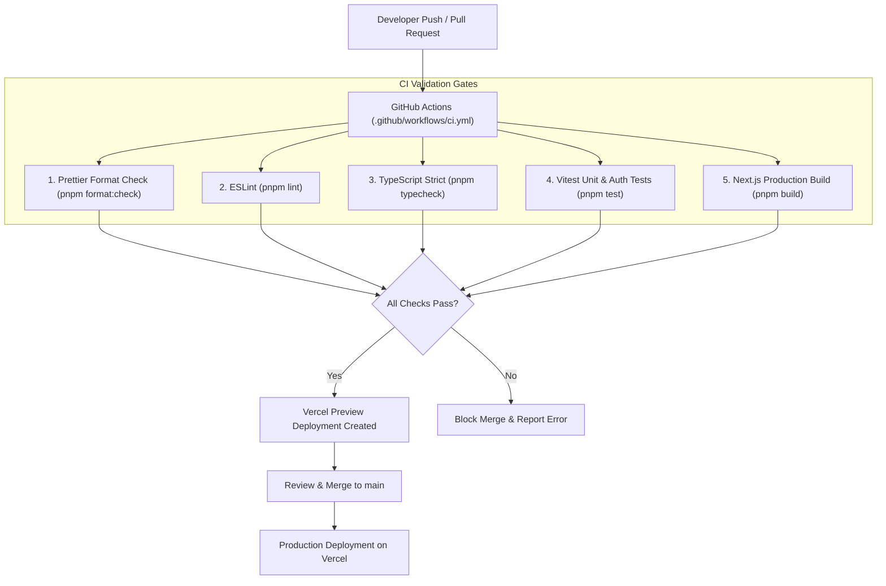

# Patemon — Deployment, CI/CD, Staging & Observability Guide

**Version:** 1.0 (MVP v1) · **Updated:** 2026-11-14 · **Phase:** 03 Foundation & Architecture ([Issue #17](https://github.com/andresanjaya/patemon/issues/17))

---

## 1. CI/CD Architecture

Patemon menggunakan **GitHub Actions** untuk memastikan setiap Pull Request diverifikasi secara otomatis sebelum dapat digabungkan (*merged*) ke branch `main`.



### 1.1 Tahapan Otomatis di Pipeline CI
Setiap run pada GitHub Actions menjalankan:
1. `pnpm format:check`: Memastikan konsistensi gaya kode sesuai Prettier.
2. `pnpm lint`: Memeriksa aturan ESLint (Next.js core web vitals & TypeScript rules).
3. `pnpm typecheck`: Memeriksa validitas type TypeScript (`tsc --noEmit`) dalam strict mode.
4. `pnpm test`: Menjalankan suite pengujian unit, matriks otorisasi RLS, dan sanitasi payload dengan Vitest.
5. `pnpm build`: Memastikan kompilasi produksi dan prerender statis berhasil tanpa error.

---

## 2. Pemisahan Lingkungan: Staging vs Production

Patemon memisahkan secara ketat lingkungan *Staging* (dan *Preview PR*) dengan *Production* guna melindungi data riil pengguna dan integritas transaksi:

| Komponen | Staging / Preview | Production |
| :--- | :--- | :--- |
| **Vercel Domain** | `patemon-*-andresanjaya.vercel.app` (Preview) | `patemon.com` / `patemon.id` (Production) |
| **Supabase Project** | Proyek Dev / Staging (`egvddkmycfbzmlafdwoc`) | Proyek Khusus Produksi (Terpisah) |
| **Database Migrations** | Diuji terlebih dahulu di database staging | Diterapkan terjadwal dengan backup |
| **Midtrans Mode** | Sandbox (`SB-Mid-...`, URL sandbox snap) | Production Merchant Account |
| **Log Level** | `debug`, `info`, `warn`, `error` | `warn`, `error` (dengan stack trace tersanitasi) |

### 2.1 Konfigurasi Environment Variables di Vercel / GitHub
Rahasia produksi dan staging harus dikonfigurasikan pada dashboard hosting (Vercel Project Settings > Environment Variables):
- `NEXT_PUBLIC_APP_URL`
- `NEXT_PUBLIC_SUPABASE_URL`
- `NEXT_PUBLIC_SUPABASE_ANON_KEY` (atau `NEXT_PUBLIC_SUPABASE_PUBLISHABLE_KEY`)
- `SUPABASE_SERVICE_ROLE_KEY` (Hanya di Server / API runtime; **jangan** ditandai expose ke browser)
- `NEXT_PUBLIC_MIDTRANS_CLIENT_KEY`
- `MIDTRANS_SERVER_KEY` (Hanya di Server runtime)

---

## 3. Observabilitas & Sanitasi Data Sensitif

Sesuai kriteria penerimaan **Issue #17**, pelacakan error dan log sistem **wajib menyaring data sensitif (*sensitive payload sanitization*)**:

### 3.1 Pencegahan Kebocoran Data (`src/lib/observability/`)
- [src/lib/observability/sanitize.ts](file:///c:/Andre/My%20Code/patemon/src/lib/observability/sanitize.ts):
  - Secara otomatis mereduksi (*redact*) nilai kunci sensitif: `password`, `token`, `secret`, `authorization`, `cookie`, `key`, `creditCard`, `phone`, `cvv`.
  - Mereduksi pola kunci rahasia dalam string: `sb_secret_*`, `gho_*`, `Bearer *`.
  - Mendukung sanitasi rekursif untuk objek bersarang (*nested object*) dan array.
- [src/lib/observability/logger.ts](file:///c:/Andre/My%20Code/patemon/src/lib/observability/logger.ts):
  - Memproduksi log terstruktur (*structured JSON*) dengan timestamp, level, lingkungan, dan konteks yang telah bersih dari data sensitif.

### 3.2 Error Boundaries Responsif
- [src/app/error.tsx](file:///c:/Andre/My%20Code/patemon/src/app/error.tsx): Menangani runtime error halaman dengan UI bertema hangat khas Bali, menyediakan tombol *Coba Lagi* dan *Kembali ke Beranda*, serta mencatat error ke `captureError` tanpa mengekspos detail teknis ke pengguna.
- [src/app/global-error.tsx](file:///c:/Andre/My%20Code/patemon/src/app/global-error.tsx): Menangkap error tingkat root layout.

---

## 4. Prosedur Rilis & Rollback (*Runbook*)

### 4.1 Prosedur Rilis Produksi
1. Pastikan seluruh acceptance criteria pada issue GitHub telah lulus.
2. Buat Pull Request dari branch fitur ke `main`.
3. Tunggu hingga seluruh status check di GitHub Actions selesai (**PASS**).
4. Review preview deployment di Vercel.
5. Merge Pull Request ke `main` (Vercel otomatis mendeploy ke branch production).
6. Lakukan verifikasi fungsional singkat (*smoke test*) pada URL produksi.

### 4.2 Prosedur Rollback Cepat
Jika terjadi insiden kritis pada rilis produksi:

#### Rollback Frontend (Vercel):
1. Buka **Vercel Dashboard > Patemon > Deployments**.
2. Cari deployment stabil sebelumnya yang berhasil.
3. Klik menu titik tiga `(...)` > pilih **Instant Rollback**.
4. Vercel akan mengalihkan 100% traffic ke build stabil sebelumnya dalam waktu < 10 detik tanpa perlu rebuild.

#### Rollback Database:
1. Hindari menghapus kolom atau tabel secara destruktif dalam satu rilis (*expand and contract pattern*).
2. Jika migrasi database perlu diperbaiki, gunakan migrasi perbaikan maju (*forward-fix migration*):
   ```bash
   pnpm dlx supabase migration new fix_issue_description
   ```
3. Terapkan migrasi perbaikan ke staging, verifikasi, lalu deploy ke production.

---

## 5. Dokumen Terkait & Runbook Lanjutan

Untuk prosedur operasional tingkat lanjut, konfigurasi DNS domain resmi, serta penanganan insiden:
- [docs/PRODUCTION-OPERATIONAL-RUNBOOK.md](file:///c:/Andre/My%20Code/patemon/docs/PRODUCTION-OPERATIONAL-RUNBOOK.md): Konfigurasi DNS/SSL, backup otomatis & PITR, pemantauan `/api/health`, dan incident response playbooks.
- [docs/SUPPORT-FAQ-AND-HELP-CENTER.md](file:///c:/Andre/My%20Code/patemon/docs/SUPPORT-FAQ-AND-HELP-CENTER.md): Panduan layanan pelanggan, penanganan refund, dan tanya-jawab operasional pawiwahan.
- [docs/SECURITY-ACCESSIBILITY-AND-PERFORMANCE-AUDIT.md](file:///c:/Andre/My%20Code/patemon/docs/SECURITY-ACCESSIBILITY-AND-PERFORMANCE-AUDIT.md): Laporan audit keamanan multi-tenant, sanitasi PII, dan aksesibilitas dialog WCAG 2.1 AA.

