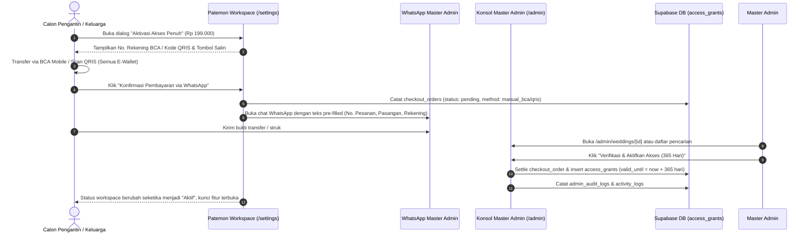

# Panduan Pembayaran Manual (BCA & QRIS) & Aktivasi Master Admin

Dokumen ini menjelaskan arsitektur baru pembayaran dan aktivasi lisensi di Patemon: Bali Hindu Wedding Planner.

---

## 1. Latar Belakang & Filosofi Model Baru

Setelah evaluasi implementasi gateway pembayaran pihak ketiga (Midtrans), diputuskan untuk beralih ke model **Manual Payment & Master Admin 1-Click Verification**:
- **Simpel & Bebas Friksi Teknis:** Menghindari kegagalan credential merchant, webhook latency, sandboxing blocker, atau perizinan third-party gateway yang kompleks.
- **Pendekatan Personal & Aman:** Pasangan dan keluarga yang ingin mengaktifkan ruang kerja perencanaan dapat mentransfer langsung ke rekening BCA atau memindai kode QRIS nasional, lalu mengonfirmasi bukti bayar via WhatsApp.
- **Kendali Penuh Master Admin:** Hanya Master Admin (pemilik platform yang terdaftar di `PLATFORM_ADMIN_EMAILS`) yang dapat mengakses konsol `/admin` untuk memverifikasi pembayaran dan mengaktifkan akses 365 hari penuh dengan satu klik.

---

## 2. Alur Pembayaran & Aktivasi (End-to-End Workflow)



---

## 3. Konfigurasi Lingkungan (`.env.local`)

Variabel yang digunakan untuk alur pembayaran manual:

```bash
# Daftar email resmi Master Admin yang memiliki hak akses ke konsol /admin
PLATFORM_ADMIN_EMAILS="andresanjaya0707@gmail.com,andresanjaya2506@gmail.com,admin@patemon.id"

# Konfigurasi Transfer Bank BCA
NEXT_PUBLIC_PAYMENT_BCA_ACCOUNT="6115701201"
NEXT_PUBLIC_PAYMENT_BCA_HOLDER="I MADE ANDRE SANJAYA"

# Nomor WhatsApp Resmi Dukungan & Konfirmasi Pembayaran (Format Internasional: 62...)
NEXT_PUBLIC_SUPPORT_WHATSAPP_PHONE="6289670356218"
```

---

## 4. Keamanan & Pembatasan Akses

1. **Gated Administrator Route:**
   - Konsol `/admin` dilindungi oleh `assertAdminSession()`.
   - Hanya akun Supabase yang email-nya terdaftar di `PLATFORM_ADMIN_EMAILS` yang dapat melihat data operasional atau memicu aksi aktivasi.
2. **Data Minimization (Privasi Keluarga):**
   - Konsol admin hanya menampilkan metadata operasional (nama pasangan, slug, status lisensi, email pemilik, riwayat order).
   - Data privat keluarga (daftar tamu, rincian banten, catatan anggaran keluarga, doa/vows) **tidak pernah dimuat** di sisi admin.
3. **Audit Trail Tak Terhapuskan:**
   - Setiap aktivasi manual mencatat entri di `admin_audit_logs` dan `activity_logs` beserta `correlation_id` unik dan email operator.
4. **Proteksi Workspace Dibekukan (*Frozen*):**
   - Jika suatu workspace sedang dibekukan karena perselisihan atau sengketa, sistem mencegah aktivasi hingga pembekuan dicabut secara sadar.
# Hapus workspace dari Master Admin

Terapkan migrasi `supabase/migrations/20261120000001_admin_soft_delete_workspace.sql` pada database target sebelum memakai fitur ini. Migrasi menambah RPC khusus `service_role`; tidak menghapus data yang sudah ada. Jika RPC belum tersedia, tindakan gagal dan baris tetap tampil.

Di `/admin`, buka menu tindakan workspace, pilih **Hapus Workspace**, ketik nama pasangan persis, lalu isi alasan minimal 10 karakter. Hanya role `superadmin` dapat menghapus; `support_operator` ditolak oleh server. Konfirmasi nama juga diperiksa ulang di DB pada baris yang dikunci.

Penghapusan berupa **soft delete** (`weddings.deleted_at`), bukan penghapusan permanen. Workspace hilang dari daftar aktif dan akses anggota ditolak melalui aturan workspace yang sudah ada. Akun Auth pemilik, data terkait, order, dan riwayat pembayaran tetap disimpan. Penghapusan dan catatan `delete_wedding` pada `admin_audit_logs` berjalan dalam satu transaksi: kegagalan salah satu membatalkan keduanya. Pemulihan belum tersedia di UI; memerlukan bantuan operasional.

Tes regresi: `pnpm exec vitest run tests/admin-delete-workspace.test.ts`. Tes memakai mock RPC dan pemeriksaan struktur SQL/UI; bukan bukti migrasi atau penghapusan telah dijalankan pada DB live. Jangan menguji dengan menghapus workspace pelanggan.
