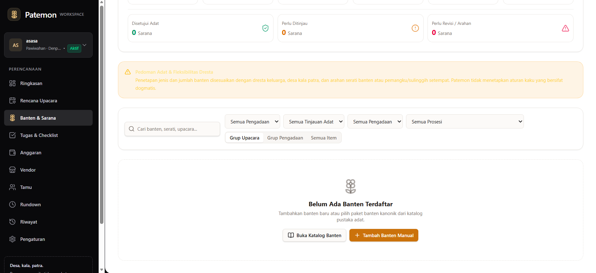
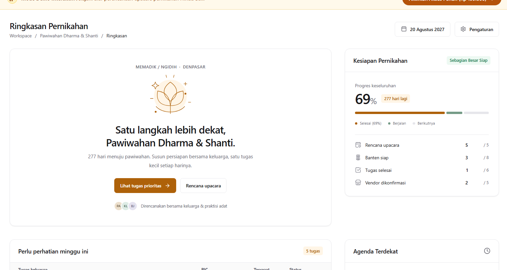
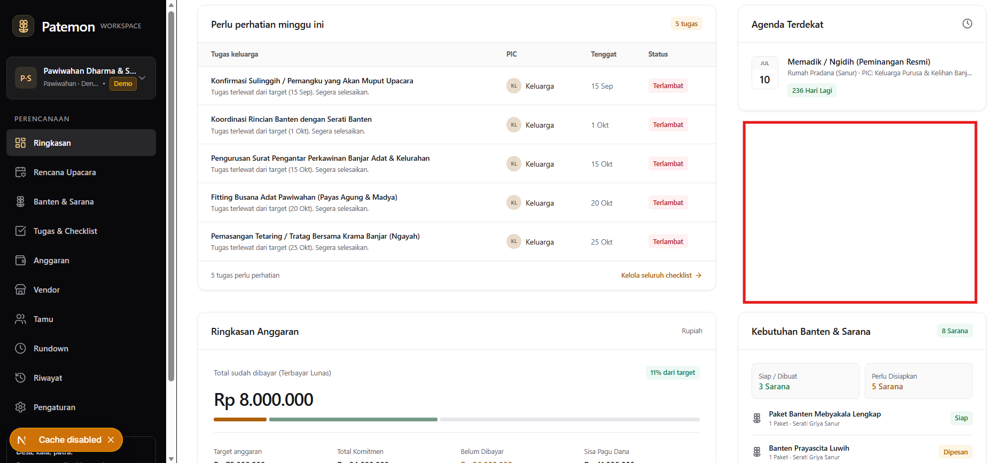
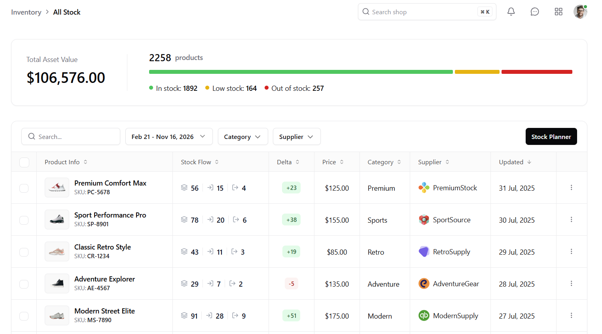
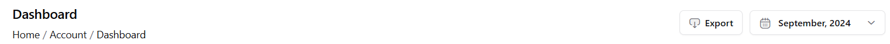
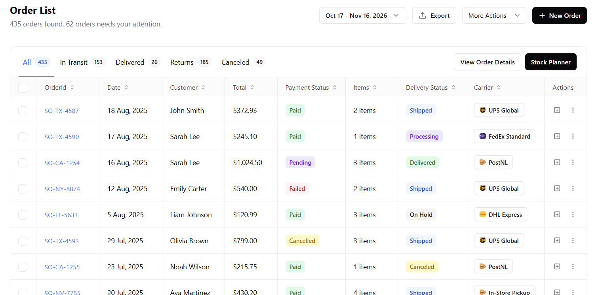
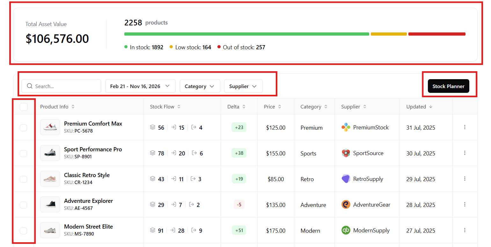
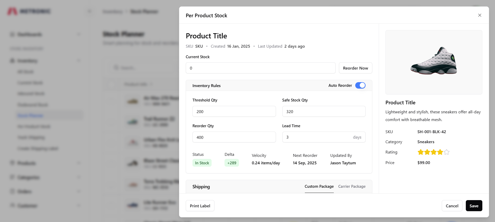

# Referensi screenshot standardisasi UI dashboard Patemon

Delapan screenshot dari permintaan 16 November 2026. Nomor file sama dengan nomor gambar pengguna. Referensi struktur terbaru untuk tiket #113–#117; font/palet tetap mengikuti #101. Seluruh path relatif terhadap root repository.

| Gambar | File | Tiket | Requirement yang memakai gambar |
|---|---|---|---|
| 1 | [01-preview-empty.png](01-preview-empty.png) | [#113](https://github.com/andresanjaya/patemon/issues/113) | Kondisi masalah: Banten & Sarana kosong sebelum bayar. Ganti dengan daftar contoh lengkap di semua menu; tombol tambah membuka modal aktivasi. Jangan meniru empty state sebagai target preview. |
| 2 | [02-bento-top.png](02-bento-top.png) | [#114](https://github.com/andresanjaya/patemon/issues/114) | Kondisi masalah: hero kiri lebih tinggi daripada kartu kesiapan kanan. Susun kolom kiri dan kanan sebagai tumpukan mandiri. |
| 3 | [03-bento-gap.png](03-bento-gap.png) | [#114](https://github.com/andresanjaya/patemon/issues/114) | Kondisi masalah: celah besar di bawah Agenda Terdekat yang ditandai merah. Kartu banten berikutnya harus langsung mengikuti agenda dengan gap standar. |
| 4 | [04-table-stock-reference.png](04-table-stock-reference.png) | [#116](https://github.com/andresanjaya/patemon/issues/116) | Target tabel: panel ringkasan di atas, toolbar pencarian/filter, checkbox seleksi, identitas utama dan metadata, border halus, status badge, aksi di kanan. |
| 5 | [05-header-reference.png](05-header-reference.png) | [#115](https://github.com/andresanjaya/patemon/issues/115) | Target header: judul kiri atas, breadcrumb di bawah, aksi di kanan; seragam di semua halaman dashboard. |
| 6 | [06-table-orders-reference.png](06-table-orders-reference.png) | [#116](https://github.com/andresanjaya/patemon/issues/116) | Target tabel: tab/status dengan counter bila tersedia, header kolom, alignment, status badge, checkbox seleksi dan menu aksi; tanpa menambah fitur e-commerce. |
| 7 | [07-table-anatomy.png](07-table-anatomy.png) | [#116](https://github.com/andresanjaya/patemon/issues/116) | Target pengelompokan yang diberi kotak merah: panel metrik terpisah, pencarian/filter kiri, CTA kanan, checkbox kiri. Checklist implementasi mencakup semua tabel/menu. Kotak merah hanya anotasi, bukan elemen UI produk. |
| 8 | [08-detail-modal-reference.png](08-detail-modal-reference.png) | [#117](https://github.com/andresanjaya/patemon/issues/117) | Target detail: modal besar, header dan X, konten utama kiri, ringkasan kanan bila ada, divider, footer aksi terjangkau saat scroll. Field tetap milik Patemon, bukan stok/produk/shipping. |

## Cara memakai

- Gambar 1–3 mendokumentasikan masalah saat ini, bukan desain akhir untuk disalin.
- Gambar 4–8 menjadi referensi layout. Gunakan hanya fitur Patemon yang sudah tersedia; warna/font dashboard tetap sesuai #101.
- Requirement, role/entitlement, aksesibilitas, responsivitas, dan kriteria penerimaan lengkap ada pada tiket terkait. Screenshot tidak menggantikan requirement tertulis.
- Folder ini disimpan dalam checkout lokal. Gambar akan dapat dibuka melalui repository GitHub setelah file di-commit dan di-push; pekerjaan dokumentasi ini tidak melakukan commit/push.

## Gambar 1 — masalah preview kosong — #113

## Gambar 2 — masalah tinggi kartu berbeda — #114

## Gambar 3 — masalah celah antarkartu — #114

## Gambar 4 — target struktur tabel dan toolbar — #116

## Gambar 5 — target judul dan breadcrumb — #115

## Gambar 6 — target tab, baris, status dan aksi tabel — #116

## Gambar 7 — target grouping panel metrik dan toolbar — #116

## Gambar 8 — target modal detail — #117

